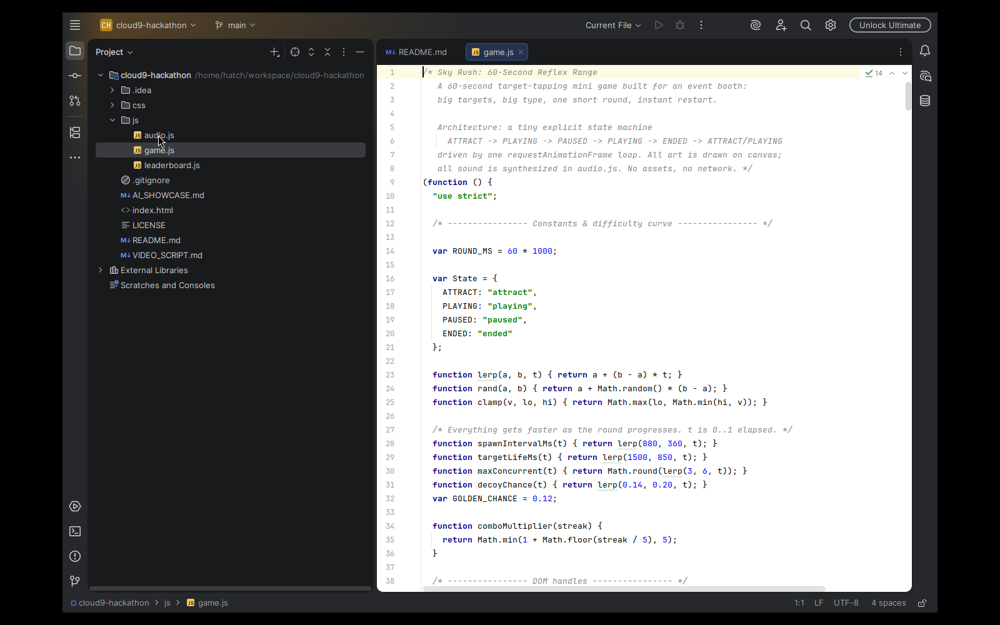

# Sky Rush: 60-Second Reflex Range

An original browser mini-game built for a **Cloud9 event booth** — Category 3
(Event Mini Game) of the *Cloud9 x JetBrains: Sky's The Limit Hackathon 2026*.

One round lasts exactly 60 seconds. Targets pop up at random spots in the
arena; tap them before they expire. Fast hits and streaks build a combo
multiplier, golden targets pay out big bonus points, and red X decoys punish
greedy clicking. When the clock runs out, the game shows your score, hits,
accuracy, and best combo — and the best five pilots of the day go on the
booth leaderboard.

Everything is handwritten HTML, CSS, and JavaScript. There is no build step,
no framework, no external font, image, or audio file: all artwork is drawn on
a `<canvas>` at runtime and all sound effects are synthesized with WebAudio.

## Run it locally

**Option A — just open it**

Open `index.html` in any modern browser (double-click the file). That's it.

**Option B — serve the folder** (handy for testing on a phone or tablet on
the same network):

```bash
# from this folder, any static server works, e.g.:
python3 -m http.server 8000
# then visit http://localhost:8000
```

The project also opens directly as a folder in IntelliJ IDEA (see
"Built with JetBrains tools" below) — use its built-in preview or any static
server to run it.

## Controls

| Action             | Mouse / keyboard             | Touch          |
| ------------------ | ---------------------------- | -------------- |
| Hit a target       | Click it                     | Tap it         |
| Start / play again | Button, or `Space` / `Enter` | Button         |
| Pause / resume     | Pause button, `P`, or `Esc`  | Pause button   |
| Mute / unmute      | Speaker button or `M`        | Speaker button |

The game also **pauses automatically** if the browser tab loses visibility
(screensaver, staff switching apps), so a round is never lost to a booth
interruption.

## Scoring rules

- **Blue target:** 60–120 points × combo multiplier. The faster you hit it
  after it appears, the closer to 120.
- **Golden target:** 300 points × combo multiplier. Rare (~12% of spawns) and
  worth chasing.
- **Combo multiplier:** every 5-hit streak raises the multiplier by 1, up to
  **x5**. Missing a click or hitting a decoy resets the streak.
- **Red X decoy:** −150 points, −1 second off the clock, streak reset, screen
  shake. Roughly 1 in 6 targets is a decoy — look before you tap.
- **Misses** count against accuracy but cost no points.
- **Difficulty ramp:** across the 60 seconds, targets spawn faster
  (0.88 s → 0.36 s average interval), expire sooner (1.5 s → 0.85 s), appear
  in larger groups (3 → 6 at once), and decoys get slightly more common.

Final stats: total score, hits, accuracy % (hits ÷ all clicks), and best
combo multiplier reached.

## Leaderboard

The top 5 scores are stored in the browser's `localStorage` on the booth
machine — nothing is uploaded anywhere. If your score makes the board, you
enter up to 3 initials, arcade style. The board is shown on both the attract
screen (to pull the next player in) and the end screen.

## Methodology

**The problem.** A booth mini-game lives or dies on queue math and failure
modes, not on content depth:

- A line of attendees is waiting; a round must be short, self-explanatory,
  and instantly restartable.
- Booth hardware is unpredictable: a laptop, a tablet, a touchscreen TV —
  maybe with no network at all.
- Staff cannot babysit software. If something interrupts the game, it must
  recover gracefully on its own.

**How Sky Rush answers it:**

1. **Queue-friendly 60-second rounds.** A fixed 60-second round means staff
   can predict throughput (~50 players/hour/station including changeover),
   and every player gets the same complete arc: warm-up, ramp, frantic
   finish. The difficulty curve is tuned so a first-timer scores
   meaningfully in the first 10 seconds but nobody "solves" the round.
2. **Zero setup.** One static folder, no build step, no dependencies, no
   accounts, no server, no network. It runs from a USB stick, a local file,
   or any static host. If the venue Wi-Fi dies, the game doesn't notice.
3. **Any device.** Mouse and touch are the same input (Pointer Events); the
   arena scales to the screen; type sizes are clamped for readability across
   a booth. The only requirement is a modern browser.
4. **Readable at three meters.** The attract screen uses huge type and a
   live leaderboard — the two things that actually pull people out of a
   walkway and into a queue. The HUD (score / time / combo) stays legible
   from behind the player.
5. **Failure-proof by design.** The game pauses itself when the tab loses
   visibility, clamps frame-time so a hiccup can't fast-forward the clock,
   and keeps working even if `localStorage` is unavailable. Sound is
   synthesized (no files to go missing) and mutable with one tap.
6. **Skill with a trap.** Decoys convert pure clicking speed into a
   look-then-tap skill, which is what makes a 60-second game replayable —
   and gives the leaderboard a real skill gradient instead of a tie at the
   top.

## Project structure

```
index.html          Page shell: HUD, arena, attract / pause / end screens
css/style.css       Booth styling (sky-blue/white palette, fluid type)
js/audio.js         Synthesized WebAudio sound effects (no audio files)
js/leaderboard.js   localStorage top-5 leaderboard
js/game.js          Game state machine, spawning, scoring, canvas rendering
AI_SHOWCASE.md      AI-assisted workflow story (bonus prize write-up)
VIDEO_SCRIPT.md     Demo video narration script + shot list
docs/               Screenshot of the project open in IntelliJ IDEA
```

## Built with JetBrains tools

This project is developed and checked in **IntelliJ IDEA 2025.3**
(build 253.28294.334), used in its free Community mode — since 2025.3
JetBrains ships a single unified distribution whose no-cost tier is the
Community feature set. The repository folder opens directly as a project
in the IDE; the committed `.idea/` folder is the one the IDE generated
for it, and the game code was reviewed with the built-in
HTML/CSS/JavaScript editing:



Two of the IDE's own engines were also run over the project from the
command line, using the same installation:

- **Code formatter** (`idea.sh format`): run over `index.html`,
  `css/style.css`, and the three files in `js/`. `index.html` was
  reformatted (indentation and line wrapping only — no content
  changes); the check pass reported the CSS and JavaScript files
  already conform to the IDE's default code style.
- **Offline inspections** (`idea.sh inspect`): run over the whole
  project using the committed inspection profile
  (`.idea/inspectionProfiles/Project_Default.xml` — 50 correctness
  checks for HTML, CSS, and JavaScript: unresolved references, unused
  symbols, invalid tags/attributes, duplicate declarations, and
  similar). The HTML/CSS/JavaScript inspections reported no problems
  in the code. All 20 findings were in the Markdown documentation —
  hyphenation and table-formatting nits, plus spell-checker false
  positives on code identifiers (`lerp`, `pointerdown`, hex colours).
  The genuine documentation nits were fixed, and a verification
  re-run confirmed the fixes; the findings that remain are the false
  positives and two weak table-formatting style warnings.

The AI-assisted parts of the workflow — drafting game-logic iterations,
reviewing the state machine, and generating test checklists — are
described in [AI_SHOWCASE.md](AI_SHOWCASE.md).

## License

MIT — see [LICENSE](LICENSE). All names, artwork, and code in this project
are original.
